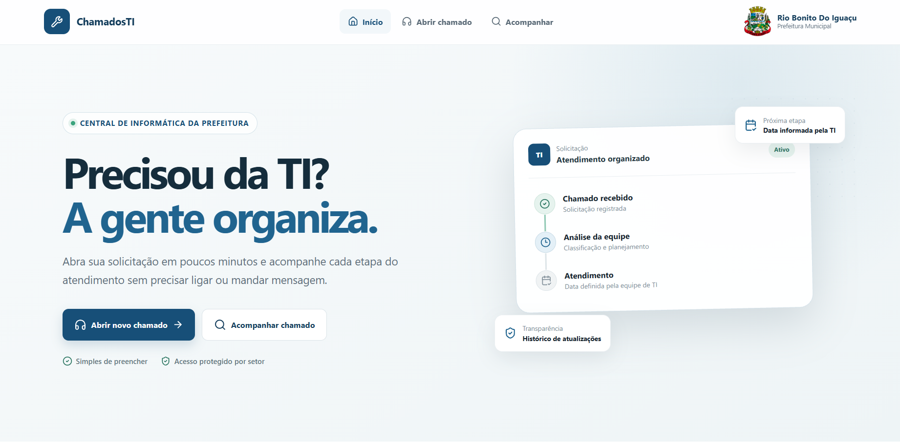
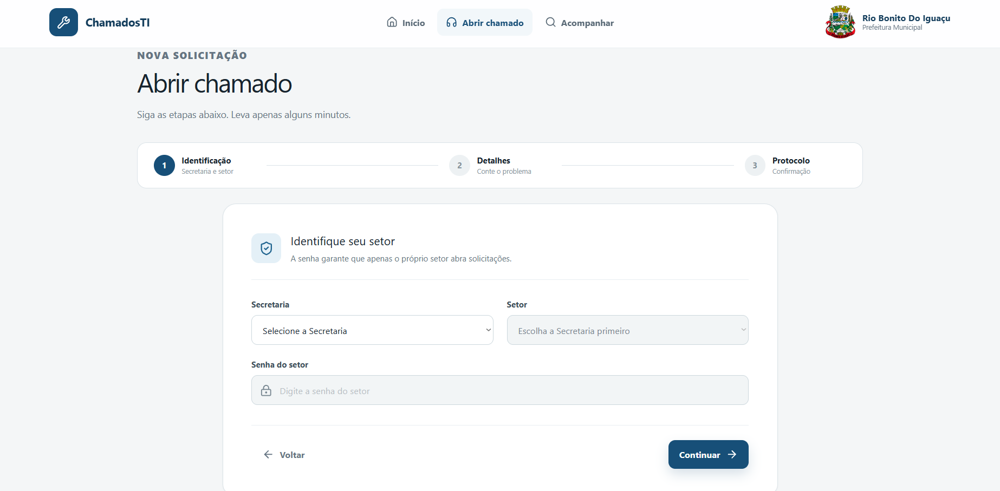
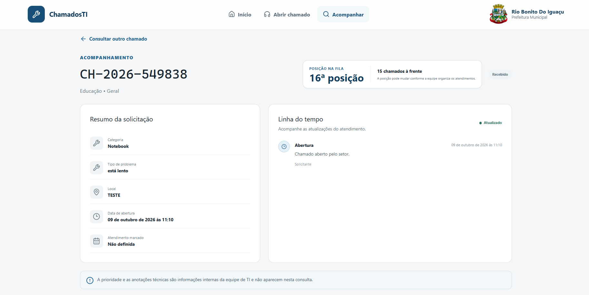
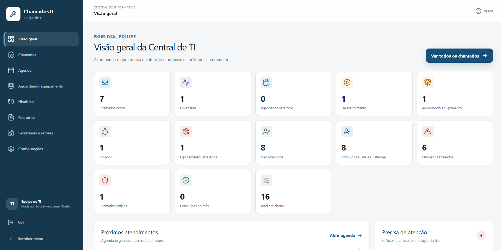
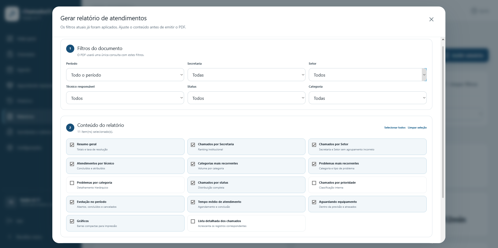

<div align="center">

# ChamadosTI

### Central de chamados e gestão de atendimentos de informática

**Do pedido de suporte ao atendimento concluído, tudo em um só lugar.**


**Projeto de uso interno · Repositório de apresentação (showcase)**

</div>

---

## Sobre o projeto

O **ChamadosTI** é um sistema desenvolvido para organizar o suporte de informática da **Prefeitura Municipal de Rio Bonito do Iguaçu**.

Antes, solicitações podiam chegar por mensagens, ligações ou conversas presenciais, sem uma fila única ou histórico completo. A proposta do sistema é centralizar essas demandas e acompanhar cada etapa: desde a abertura do chamado até sua conclusão.

A aplicação reúne **duas experiências conectadas**: uma área em que os servidores registram e acompanham solicitações, e um painel administrativo em que a equipe de TI classifica, agenda e gerencia os atendimentos.

## Telas do sistema

### 1. Página inicial

O ponto de entrada para abrir um chamado ou acompanhar uma solicitação existente.



### 2. Abertura de chamados

O servidor identifica sua Secretaria e Setor, informa a senha do setor e descreve a solicitação. O fluxo é dividido em etapas e gera um protocolo para acompanhamento.



### 3. Acompanhamento

Pelo protocolo e pela identificação do setor, o solicitante consulta o andamento, a posição na fila, as datas e a linha do tempo. Informações internas da TI não aparecem nessa visualização.



### 4. Painel da equipe de TI

Uma visão dos chamados novos, em análise, agendados, atrasados, em atendimento e aguardando equipamento, além de indicadores e próximos atendimentos.



### 5. Relatórios em PDF

A equipe seleciona filtros e escolhe quais análises deseja incluir no relatório, como atendimentos por técnico, distribuição por setor, categorias e evolução ao longo do tempo.



---

## Funcionalidades

### Área do solicitante

- **Abertura sem conta individual:** identificação da Secretaria e Setor com validação de acesso por senha do setor.
- **Formulário completo:** categoria, equipamento, local, descrição do problema e anexos opcionais.
- **Protocolo exclusivo:** identificação para consultar e acompanhar cada solicitação.
- **Acompanhamento:** status, data prevista, adiamentos, justificativas públicas, histórico e posição na fila.
- **Visibilidade controlada:** dados administrativos, observações internas e chamados de outros setores não aparecem para o solicitante.

### Área da equipe de TI

- **Painel geral:** indicadores operacionais e demandas que precisam de atenção.
- **Fila por prioridade:** chamados ainda não classificados aparecem primeiro; depois, a ordem segue crítica, alta, normal e baixa, respeitando a antiguidade.
- **Atribuição de técnicos:** um ou mais responsáveis por atendimento.
- **Agenda:** primeiro agendamento e registro de adiamentos posteriores com justificativa.
- **Aguardando equipamento:** controle do item necessário, previsão e retorno ao fluxo após o recebimento.
- **Histórico:** registro das alterações, consultas por filtros e possibilidade de reativar atendimentos encerrados.
- **Registro administrativo:** a equipe também pode cadastrar solicitações recebidas por outros canais, mantendo o mesmo fluxo.
- **Administração:** gerenciamento de Secretarias, Setores e técnicos sem precisar modificar o código.

### Relatórios e indicadores

Os relatórios utilizam os dados registrados nos chamados e podem ser exportados em **PDF**.

Entre as informações disponíveis estão volumes por período e status, atendimentos por técnico, Secretarias e Setores com mais solicitações, categorias recorrentes, atrasos, adiamentos e tempos de atendimento.

Os filtros permitem adaptar a análise ao período e aos setores desejados, e a composição do PDF pode ser personalizada.

## Fluxo de atendimento

```text
Abertura → Análise e prioridade → Responsável → Agendamento
                ↓                              ↓
          Acompanhamento ← Atendimento ← Aguardando equipamento
                ↓
         Conclusão → Histórico e relatórios
```

O fluxo foi pensado para evitar que uma solicitação se perca ou fique sem justificativa quando precisa ser reagendada ou aguardar a chegada de um equipamento.

## Tecnologias e arquitetura

| Tecnologia | Papel no sistema |
| --- | --- |
| **React + TypeScript** | Interface para servidores e equipe administrativa |
| **C# / ASP.NET Core** | API e regras de negócio |
| **Entity Framework Core** | Acesso e mapeamento dos dados |
| **PostgreSQL** | Armazenamento de chamados, usuários, estados e histórico |
| **Supabase Storage** | Armazenamento privado de anexos |

A interface se comunica com a **API ASP.NET Core**, responsável por validar solicitações, controlar permissões, executar as regras de negócio e acessar o banco de dados.

### Segurança e integridade

O sistema inclui autenticação administrativa, controle de acesso por setor, gerenciamento de sessão, limites de requisição, validação de arquivos enviados e auditoria das ações importantes.

Os anexos ficam em armazenamento privado, com acesso temporário autorizado. As permissões também separam o que o solicitante pode consultar das informações operacionais disponíveis somente à equipe.

## Desafios de desenvolvimento

Construir o ChamadosTI envolveu mais do que montar formulários e telas:

- Estruturar uma **fila de atendimento com prioridades e regras claras**.
- Preservar o histórico mesmo quando um chamado é adiado, cancelado ou reativado.
- Separar dados públicos e internos sem comprometer o acompanhamento do solicitante.
- Organizar os estados do atendimento para que cada ação tenha um fluxo consistente.
- Integrar **frontend, API, banco de dados, armazenamento de anexos e geração de relatórios**.

## Meu papel no projeto

Trabalhei no desenvolvimento do ChamadosTI, incluindo a criação das interfaces, a implementação das regras de atendimento, a integração entre frontend e backend e a organização dos dados e relatórios.

É um projeto que conecta minha experiência cotidiana com suporte técnico à prática de desenvolvimento de software: o objetivo foi resolver um problema real e deixar o trabalho da equipe mais organizado e rastreável.

## Sobre o código-fonte

O ChamadosTI é utilizado em um ambiente institucional. Por isso, **o código-fonte e os dados operacionais não estão disponíveis publicamente**.

Este repositório é uma vitrine do projeto, com a apresentação das funcionalidades, imagens e decisões técnicas, sem disponibilizar a aplicação original.

---

<div align="center">

**Desenvolvido por [Luiz Henrique de Pieri](https://github.com/luizhp0)**

[LinkedIn](https://www.linkedin.com/in/luizhenriquedepieri) • [Contato](mailto:oficialluizff@gmail.com)

</div>
